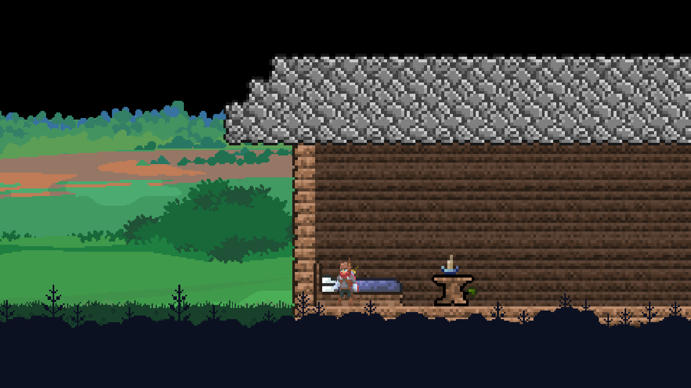
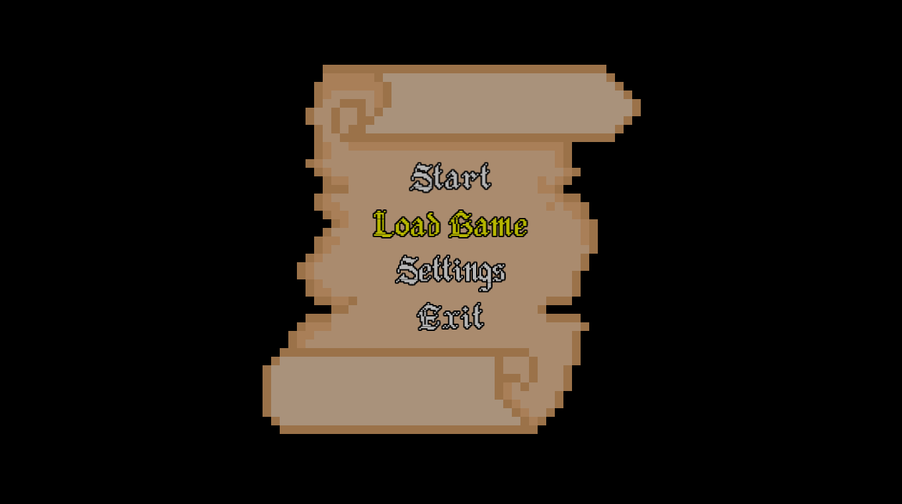
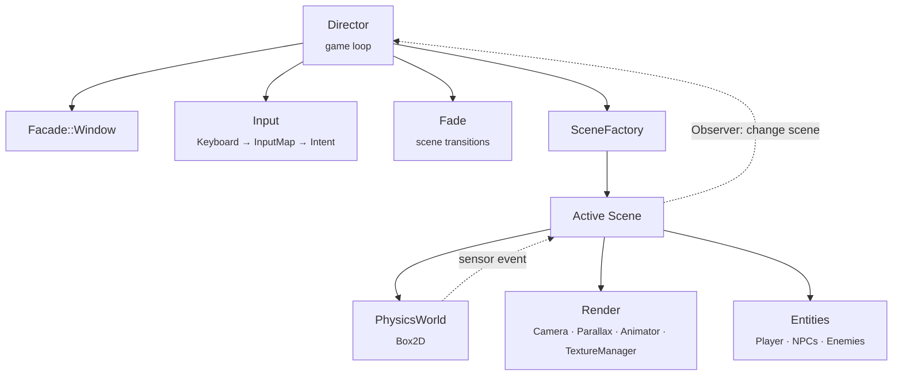

<div align="center">

# ⚔️ Furdom Kingdoms

**A 2D side-scrolling action-platformer written in C++ with SFML and Box2D**




<sub>House scene: parallax background, physics-driven player and scene props.</sub>

</div>

---

## 📖 About

Furdom Kingdoms began as the final project for **Programming II** at **UTN – Facultad Regional General Pacheco** (Argentina). This repository holds a full rewrite of that project. It keeps the original gameplay and puts it on a cleaner, modular architecture built around clear ownership, decoupled systems and explicit state handling.

> 🚧 **Work in progress.** The current goal is to match the original game's content on the new architecture before adding new features.

---

## ✨ Current Features

| | Feature | Description |
|---|---|---|
| 🏠 | **Main menu → House scene** | Keyboard-driven menu that leads into the first playable level. |
| 🏃 | **Physics-based movement** | The player runs, jumps and falls using Box2D bodies and collisions. |
| 🎞️ | **Sprite animations** | Idle, run, jump and fall animations driven by an `Animator` component. |
| 🌄 | **Parallax backgrounds** | Five background layers scrolling at different speeds for depth. |
| 🎥 | **Camera system** | Multiple camera modes (follow player, fixed, free) implemented as swappable behaviors. |
| 📡 | **Event-driven triggers** | Physics sensors notify the scene through the Observer pattern to fire in-game events. |
| 🌑 | **Scene transitions** | Fade-out / fade-in between scenes, created on demand by a scene factory. |

<p align="center">
  
  <br><sub>Main menu</sub>
</p>

---

## 🏗️ Architecture



### Design decisions

- **🧩 Clear ownership.** Every system has a single owner, expressed with `std::unique_ptr`. The `Director` owns the window, input and active scene, and its destructor is simply `= default`.
- **🏭 Factory pattern.** Scenes are created from a compile-time table of constructors indexed by a `PortalID`, so adding a new level does not require touching the game loop.
- **👁️ Observer pattern.** Physics sensors and scenes communicate through events, not direct references. A scene does not know who is listening.
- **🪟 Facade pattern.** `Facade::Window` and `Facade::PhysicsBody` wrap SFML and Box2D so that game code depends on small, stable interfaces rather than on the libraries directly.
- **🎮 Input → Intent.** Raw keys are mapped to actions (`InputMap`), and the actions are turned into an `Intent` (move, jump, attack). Gameplay code never reads keys directly, which makes controls rebindable.
- **🔁 State as behavior.** Behaviors that persist for many frames (camera modes, transitions) are selected once, when the state changes, through member-function pointers, instead of being re-checked with conditionals every frame.
- **🖼️ Load once, reuse.** Textures are loaded a single time by a `TextureManager` and shared by reference.

---

## 🎮 Controls

| Key | Action |
|:---:|---|
| `W` / `S` or `↑` / `↓` | Navigate menu |
| `Enter` | Select |
| `A` / `D` | Move left / right |
| `Space` | Jump |
| `Esc` | Quit |

### 🧪 Developer Tools

Built-in tools used while designing levels:

| Key | Tool |
|:---:|---|
| `↑` `↓` `←` `→` | Move a test physics body |
| `I` `J` `K` `L` | Resize the test body |
| `Enter` | Print the body's size and position, ready to paste into code |
| `Q` / `E` | Camera: follow player / fixed position |
| `R` | Print camera center and size |

A Box2D debug renderer (`FooDraw`) can also be enabled to visualize colliders.

---

## 📁 Project Structure

Headers live in `include/` and implementations in `src/`, both following the same module layout:

```
include/ · src/
├── core/        # Director (game loop) and scene fades
├── scenes/      # Menu, House and test scenes + SceneFactory
├── entities/    # Player, NPCs, enemies and physics bounds
├── components/  # Reusable gameplay components (jump, enemy sensors)
├── physics/     # Box2D world, collision handling, debug drawing
├── render/      # Camera, parallax layers, animator, texture manager
├── input/       # Keyboard state, key → action mapping, Intent
├── events/      # Observer / Subject templates
├── facade/      # Thin wrappers over SFML and Box2D
├── interfaces/  # Small abstract interfaces (camera target, drawable)
└── utils/       # Vector types, casts, unit conversion
```

---

## 🧰 Tech Stack

| Library | Version | Note |
|---|---|---|
| [SFML](https://www.sfml-dev.org/) | **2.6.x** | Rendering, windowing, input and audio. |
| [Box2D](https://box2d.org/) | **2.4.x** | Physics and collisions (pre-3.0, C++ API). |

Written in C++17 and developed with GCC / MinGW-w64.

> 📌 This repository contains the **source code only**. Game assets (textures, fonts, audio) and build files are not included.

---

## 🗺️ Roadmap

- [x] Modular architecture (Director, scenes, facades, factories)
- [x] Physics-based player movement and animations
- [x] Parallax backgrounds and camera modes
- [x] Sensor-triggered events via Observer
- [ ] Pause menu
- [ ] Port the remaining scenes from the original version (city, tavern, forest, dungeon, castle)
- [ ] Enemies and combat
- [ ] Player state machine (idle / run / jump / fall / attack)
- [ ] Ending cutscene: a sensor triggers a camera pull-back while the character keeps running and the credits roll

---

<div align="center">

Developed by **[Yamil González](https://github.com/yamilGonzalezDev)**

</div>
